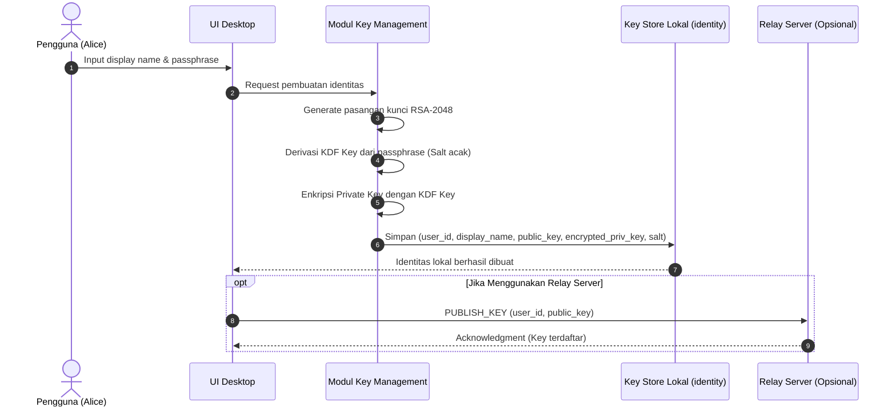
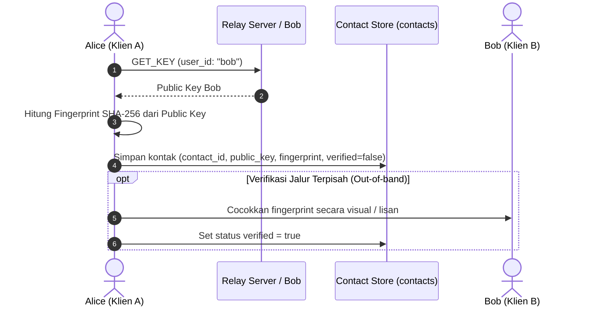
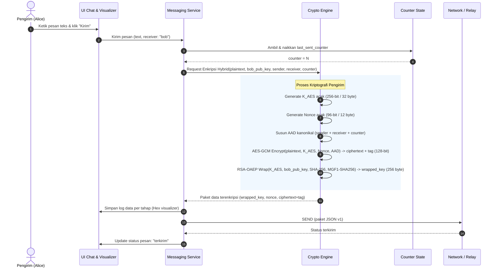
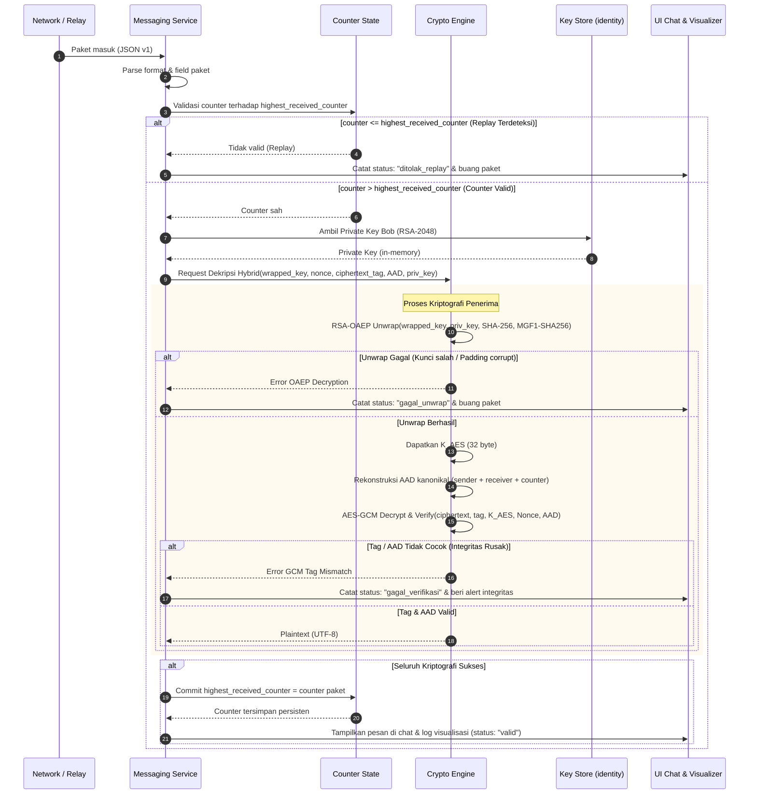
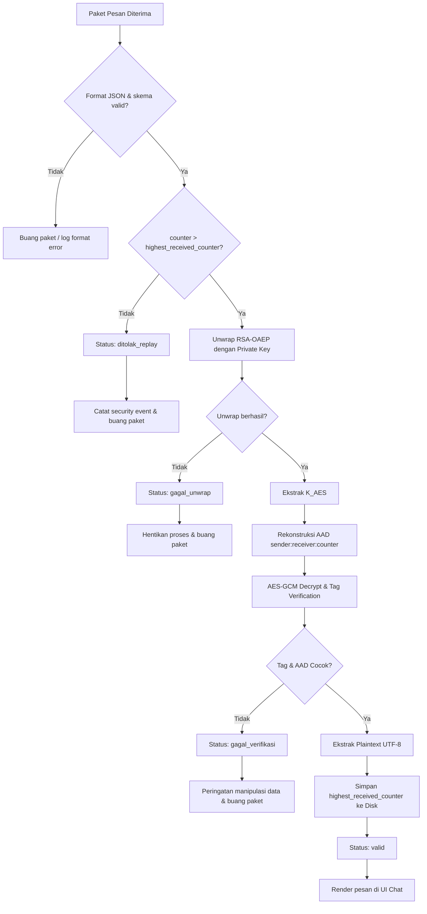
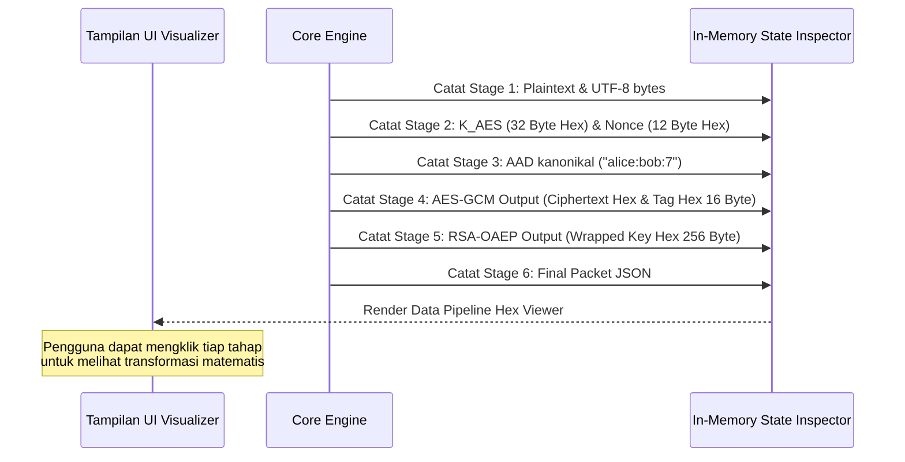
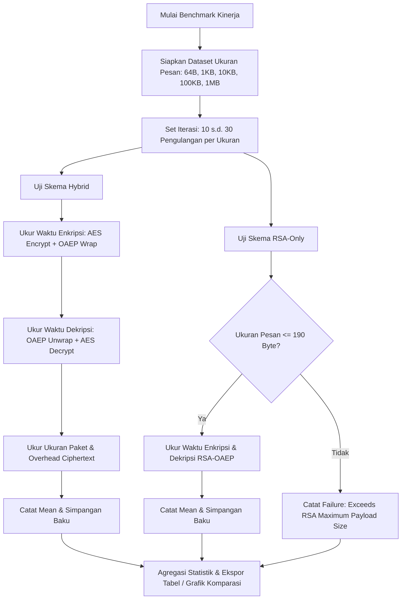
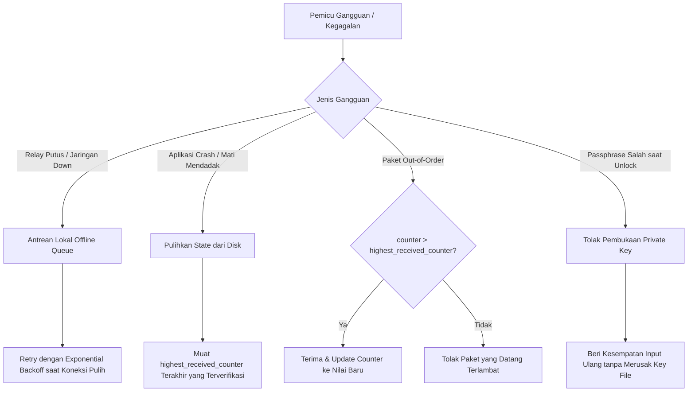

# Workflow dan Alur Proses

Dokumen ini mendefinisikan alur kerja operasional, proses kriptografi langkah-demi-langkah, penanganan verifikasi dan anti-replay, mode visualisasi, simulasi serangan, hingga benchmark kinerja pada prototipe aplikasi chat desktop dengan enkripsi hybrid AES-256-GCM dan RSA-OAEP SHA-256.

---

## 1. Bootstrap Akun dan Manajemen Kunci

Pada aplikasi chat desktop ini, identitas pengguna dan pasangan kunci RSA dibuat secara lokal di sisi klien. Private key dilindungi menggunakan enkripsi simetris berbasis passphrase pengguna (KDF: PBKDF2 atau Argon2) sebelum disimpan ke penyimpanan lokal (`identity`).

Public key dipertukarkan antar pengguna, baik secara langsung (mode socket peer-to-peer) maupun melalui perantara relay server (`PUBLISH_KEY` dan `GET_KEY`).

### Pertukaran Public Key Lawan Bicara

> [!NOTE]
> Karena sistem tidak menggunakan Public Key Infrastructure (PKI) atau Certificate Authority (CA), verifikasi fingerprint secara out-of-band adalah satu-satunya mekanisme verifikasi keaslian public key untuk mendeteksi serangan Man-in-the-Middle (MITM).

---

## 2. Alur Pengiriman Pesan (Enkripsi Hybrid)

Pengiriman pesan menerapkan enkripsi hybrid:
1. Isi pesan dienkripsi dengan **AES-256-GCM** menggunakan kunci simetris yang dibangkitkan baru untuk setiap pesan.
2. Kunci AES tersebut dibungkus (**wrapped**) menggunakan **RSA-OAEP SHA-256** dengan public key penerima.
3. Metadata pengiriman (`sender`, `receiver`, `counter`) diikat sebagai *Additional Authenticated Data* (AAD) pada AES-GCM.

### Rincian Pembentukan Paket Pesan

- **Kunci AES ($K_{AES}$):** 32 byte pseudorandom dibangkitkan segar per pesan. Menghilangkan risiko penggunaan ulang nonce pada kunci yang sama (*nonce reuse*).
- **Nonce GCM:** 12 byte (96 bit) pseudorandom sesuai rekomendasi NIST SP 800-38D.
- **AAD (Associated Data):** Representasi kanonikal `sender + ":" + receiver + ":" + counter`. Mengikat identitas pengirim, penerima, dan urutan pesan secara kriptografis tanpa mengekspos isi pesan.
- **Wrapped Key:** Kunci AES 32 byte dienkripsi dengan RSA-OAEP parameter SHA-256 (panjang output 256 byte untuk RSA-2048).

---

## 3. Alur Penerimaan dan Dekripsi Pesan

Sisi penerima memvalidasi paket secara ketat melalui tahapan berjenjang:
1. Pengecekan counter anti-replay.
2. Pembukaan (*unwrapping*) kunci AES menggunakan private key RSA penerima.
3. Verifikasi integritas AAD dan tag autentikasi AES-GCM, dilanjutkan dekripsi isi pesan.
4. Pembaruan state counter hanya jika seluruh tahap verifikasi berhasil.

---

## 4. Alur Validasi Idempotency, State Counter, dan Anti-Replay

Pengelolaan status counter mencegah serangan replay dan memastikan konsistensi state. Diagram berikut menggambarkan alur pengambilan keputusan pada setiap pesan yang diterima:

### Aturan Kritis Pembaruan Counter
> [!IMPORTANT]
> `highest_received_counter` **hanya diperbarui secara persisten setelah verifikasi tag AES-GCM berhasil**. 
> Jika counter dinaikkan sebelum verifikasi tag selesai, penyerang dapat melancarkan serangan *Denial of Service* (DoS) sederhana: mengirim paket palsu dengan nilai counter sangat besar ($N = 999999$). Bila counter dinaikkan prematur, semua pesan sah berikutnya dari pengirim asli akan ditolak permanen sebagai replay.

---

## 5. Alur Mode Visualisasi Kriptografi

Mode visualisasi dirancang untuk kepentingan edukasi dan transparansi audit pada pengujian akademik. Mode ini mengekstrak nilai heksadesimal dari variabel kriptografi di setiap tahap pemrosesan tanpa membocorkannya ke disk atau log permanen.

### Parameter yang Ditampilkan pada Mode Visualisasi

| Tahap | Parameter | Tipe Representasi | Keterangan |
| --- | --- | --- | --- |
| 1. Input | Plaintext | String / UTF-8 Hex | Isi pesan asli sebelum diamankan |
| 2. Kunci Simetris | $K_{AES}$ | 64 karakter Hex (256-bit) | Kunci acak unik per pesan |
| 3. Inisialisasi IV | Nonce GCM | 24 karakter Hex (96-bit) | Nonce acak unik per pesan |
| 4. Pengikatan Metadata | AAD | ASCII String & Byte Hex | `sender:receiver:counter` |
| 5. Enkripsi Data | Ciphertext + Tag | Hex stream + Tag 16 Byte Hex | Bukti kerahasiaan dan integritas |
| 6. Pembungkusan Kunci | Wrapped Key | 512 karakter Hex (2048-bit) | $K_{AES}$ dienkripsi RSA-OAEP Bob |
| 7. Verifikasi & Unwrap | Unwrap & Tag Status | Status badge (`OK` / `FAIL`) | Hasil pemeriksaan integritas penerima |

---

## 6. Alur Simulasi Skenario Serangan

Simulasi serangan dijalankan di lingkungan uji untuk membuktikan ketahanan sistem terhadap ancaman aktif secara empiris.

```mermaid
flowchart TD
  subgraph Skenario_1 [Skenario 1: Modifikasi Ciphertext / Tag]
    S1A[Paket Asli] --> S1B[Flip 1 Bit / Modifikasi 1 Byte Ciphertext/Tag/Nonce]
    S1B --> S1C[Penerima: Eksekusi AES-GCM Tag Verify]
    S1C --> S1D{Tag Valid?}
    S1D -- Tidak --> S1E[PASS: Verifikasi Gagal, Paket Ditolak]
    S1D -- Ya --> S1F[FAIL: Sistem Tidak Aman]
  end

  subgraph Skenario_2 [Skenario 2: Private Key Salah]
    S2A[Paket untuk Bob] --> S2B[Penerima mencoba buka dengan Private Key Eve]
    S2B --> S2C[Penerima: Eksekusi RSA-OAEP Decrypt]
    S2C --> S2D{Unwrap Berhasil?}
    S2D -- Tidak --> S2E[PASS: OAEP Padding Check Gagal, Eksekusi Berhenti]
    S2D -- Ya --> S2F[FAIL: Kunci Tidak Sesuai Berhasil Dekripsi]
  end

  subgraph Skenario_3 [Skenario 3: Serangan Replay]
    S3A[Paket counter N Berhasil Diterima] --> S3B[Injeksi Ulang Paket N yang Sama]
    S3B --> S3C[Penerima: Periksa counter <= highest_received_counter]
    S3C --> S3D{Lolos Filter?}
    S3D -- Tidak --> S3E[PASS: Ditolak di Lapisan Awal Sebelum Kripto]
    S3D -- Ya --> S3F[FAIL: Replay Diterima]
  end
```

### Matriks Pengujian Simulasi Serangan

| ID Uji | Skenario | Titik Serangan | Perilaku yang Diharapkan | Hasil / Status |
| --- | --- | --- | --- | --- |
| ATK-01 | Bit-flipping Ciphertext | 1 byte diubah pada ciphertext | AES-GCM tag verification gagal; status `gagal_verifikasi` | Lolos uji negatif |
| ATK-02 | Tag Tampering | 1 byte diubah pada authentication tag | GCM tag mismatch; pesan ditolak | Lolos uji negatif |
| ATK-03 | AAD Tampering | Field `sender` atau `counter` diubah di JSON | Tag verification gagal karena AAD tidak cocok | Lolos uji negatif |
| ATK-04 | Wrong Private Key | Dekripsi dengan private key pihak ketiga | RSA-OAEP unwrap gagal; status `gagal_unwrap` | Lolos uji negatif |
| ATK-05 | Replay Attack | Mengirim ulang paket yang sudah diproses | Ditolak oleh rule `counter <= highest`; status `ditolak_replay` | Lolos uji negatif |
| ATK-06 | Nonce Reuse Demo (Bonus) | Enkripsi 2 pesan berbeda dengan K_AES & Nonce sama | Menunjukkan kebocoran XOR plaintext & kegagalan keaslian | Lolos demonstrasi |

---

## 7. Alur Pengujian Benchmark Kinerja

Benchmark membandingkan efisiensi waktu pemrosesan dan batasan muatan (*payload limit*) antara skema **Enkripsi Hybrid (AES-GCM + RSA-OAEP)** dan skema **RSA-Only (RSA-OAEP murni)**.

### Catatan Penting Batasan RSA-Only:
Pada kunci RSA-2048 bit dengan padding RSA-OAEP SHA-256:
$$\text{Max Payload} = \text{KeySize} - 2 \cdot hLen - 2 = 256 - 2(32) - 2 = 190 \text{ byte}$$
Untuk ukuran pesan $\ge 190$ byte, skema RSA-Only secara matematis mengalami kegagalan (*overflow exception*), membuktikan kebutuhan mutlak terhadap enkripsi hybrid untuk aplikasi komunikasi data riil.

---

## 8. Penanganan Kegagalan, Recovery, dan Edge Cases

### Ringkasan Strategi Pemulihan

1. **Jaringan Terputus:** Pesan yang belum terkirim ditampung dalam antrean memori lokal klien dan dikirim ulang saat socket terhubung kembali.
2. **Crash Consistency:** State counter disimpan secara atomik pada database/berkas lokal sesaat setelah verifikasi tag sukses, mencegah pemutaran ulang counter saat aplikasi dimulai kembali (*restart*).
3. **Ketidakcocokan Parameter OAEP:** Jika dua klien menggunakan hash berbeda (misalnya salah satu memakai default MGF1-SHA1), modul kripto mengembalikan error deskriptif eksplisit (`INVALID_PADDING_OR_HASH_MISMATCH`) dan tidak membiarkan crash tanpa penanganan.

---

## 9. Kondisi Akhir yang Diinginkan

Implementasi alur kerja sistem harus memenuhi kriteria berikut:

1. **Kebenaran Fungsional (*Correctness*):** Pesan teks pendek, pesan panjang berukuran megabyte, dan karakter Unicode/emoji terenkripsi dan terdekripsi 100% identik dengan teks asal.
2. **Kerahasiaan Mutlak di Transit (*Confidentiality*):** Inspeksi paket jaringan melalui sniffer (misal Wireshark) hanya memperlihatkan ciphertext acak dan metadata paket; tidak ada plaintext maupun kunci AES yang terekspos.
3. **Integritas Tak Terkompromi (*Integrity*):** Perubahan 1 bit tunggal pada ciphertext, tag, nonce, maupun metadata AAD selalu ditolak oleh verifikasi AES-GCM.
4. **Ketahanan Replay Teruji (*Anti-Replay*):** Paket lama yang dikirim ulang selalu ditolak sebelum masuk ke proses dekripsi kunci asimetris.
5. **Observabilitas Transparan:** Mode visualisasi menyediakan representasi hex terstruktur pada setiap tahapan untuk keperluan edukasi dan pengujian dosen/penilai.
6. **Kinerja Terukur dan Terdokumentasi:** Hasil benchmark menunjukkan efisiensi skema hybrid dibandingkan RSA-only, lengkap dengan data rata-rata, deviasi standar, dan grafik komparasi.
