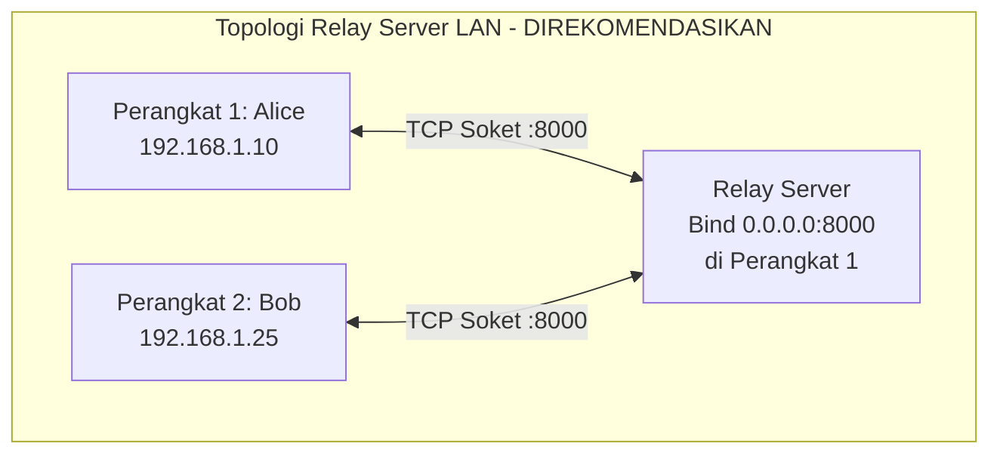
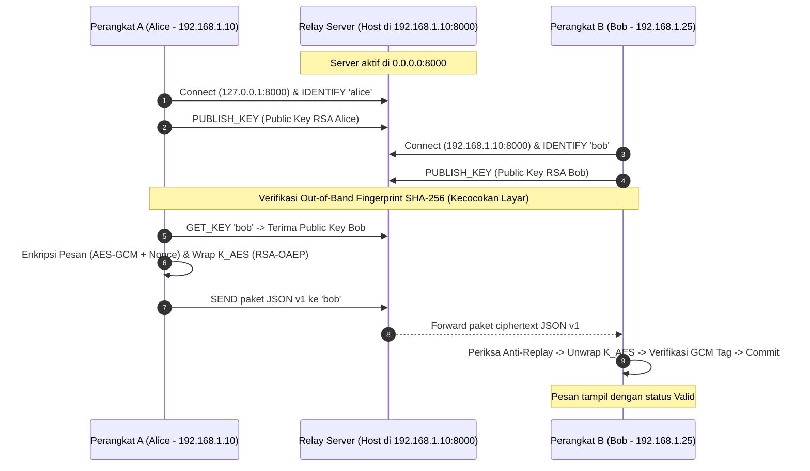

# Rencana Implementasi: Komunikasi Antar-Device pada Jaringan Lokal (LAN / Wi-Fi)

Dokumen ini memuat rencana terperinci, analisis arsitektur, kebutuhan modifikasi kode, mitigasi keamanan jaringan, serta panduan konfigurasi sistem operasi untuk memungkinkan prototipe aplikasi chat desktop berkomunikasi secara *real-time* dan *end-to-end* antar-perangkat fisik yang berbeda (misalnya: dua laptop atau PC dalam satu jaringan Wi-Fi/LAN yang sama).

---

## 1. Latar Belakang & Tujuan

Saat ini, pengujian aplikasi telah berjalan sukses pada lingkungan *single-device* (*localhost* loopback `127.0.0.1`). Untuk keperluan demonstrasi perkuliahan tingkat lanjut atau pengujian empiris nyata, sistem perlu diperluas agar dapat menghubungkan **dua perangkat fisik berbeda** tanpa mengubah prinsip inti kriptografi yang telah dibangun:
- Tetap menerapkan **Zero-Knowledge Architecture** (server perantara tidak dapat membaca isi pesan atau kunci privat).
- Tetap menerapkan **Enkripsi Hybrid AES-256-GCM & RSA-2048-OAEP**.
- Tetap memvalidasi **Anti-Replay Counter** dan **Integritas AAD Kanonikal** antar-perangkat.

---

## 2. Analisis Topologi Jaringan LAN

Terdapat dua pendekatan arsitektur untuk komunikasi lokal:



### Mengapa Menggunakan Topologi Zero-Knowledge Relay di LAN?
1. **Firewall Friendly (Hanya 1 Port Masuk):** Hanya perangkat penyedia Relay yang perlu membuka port *inbound* (port 8000). Perangkat klien lain (Bob) hanya melakukan koneksi keluar (*outbound TCP*) yang biasanya diizinkan secara default oleh firewall Windows/macOS.
2. **Direktori Kunci Publik Otomatis:** Alice dan Bob tidak perlu bertukar file kunci secara manual melalui flashdisk; kunci publik dipublikasikan secara aman ke relay (`PUBLISH_KEY`) dan diambil saat sesi obrolan dimulai (`GET_KEY`).
3. **Mendukung Antrean Pesan Offline (Store-and-Forward):** Jika Bob sedang terputus sejenak dari Wi-Fi, paket ciphertext tersimpan di antrean RAM relay dan diteruskan saat Bob kembali online.
4. **Sifat Zero-Knowledge Terjamin:** Walaupun traffic melintasi jaringan Wi-Fi lokal, seluruh muatan adalah ciphertext Base64. Bahkan jika ada penyadap (Eve) yang menjalankan Wireshark di jaringan Wi-Fi yang sama, isi pesan dan kunci simetris tetap tidak dapat dibongkar.

---

## 3. Analisis Kesiapan Kode (*Gap Analysis*)

Secara fundamental, modul jaringan inti pada repositori saat ini **sudah siap mendukung jaringan lintas perangkat**:
- `src/network/relay_client.py` telah menerima parameter `host` dan `port` bebas.
- `client/app.py` telah memiliki parameter `relay_host` dan `relay_port`.
- `relay/server.py` telah mendukung multithreading socket server.

### Kebutuhan Modifikasi Kode (*Code Delta*):

| Komponen | Berkas | Status Saat Ini | Kebutuhan Modifikasi |
| :--- | :--- | :--- | :--- |
| **CLI Argument Client** | `client/main.py` | Hanya menerima `--user`, `--db`, `--port` | Menambahkan argument `--relay-host` dan `--relay-port` agar pengguna dapat menentukan IP server relay dari terminal. |
| **Default Binding Server** | `relay/server.py` | Default bind ke `127.0.0.1` | Mengubah default host menjadi `0.0.0.0` atau menambahkan auto-detection IP LAN lokal agar otomatis mencetak IP LAN host saat server aktif. |
| **Dialog Inisialisasi UI** | `client/ui/key_dialog.py` | Hanya input Passphrase & Nama | *(Peningkatan Opsional)* Menambahkan input teks "Relay Host IP" pada UI agar pengguna non-teknis tidak wajib mengetik via terminal. |

---

## 4. Alur Kerja Komunikasi Antar-Device



### Mitigasi Ancaman Jaringan Wi-Fi Lokal (Model Keamanan):
1. **Penyadapan Paket (*Passive Eavesdropping* / Sniffing Wi-Fi):**
   - Penyerang yang menangkap paket di Wi-Fi hanya melihat teks terenkripsi JSON v1. Kunci simetris terproteksi RSA-OAEP 2048-bit.
2. **Pemalsuan Kunci Publik (*ARP Spoofing / MITM Attack*):**
   - Sebelum memulai obrolan rahasia, Alice dan Bob saling membacakan **Fingerprint SHA-256** (8 blok heksadesimal) yang tampil di antarmuka masing-masing. Jika penyerang menyisipkan kunci palsu di relay, nilai fingerprint di layar Alice dan Bob tidak akan cocok.
3. **Injeksi Ulang di Jaringan (*Replay Attack*):**
   - Jika penyerang menyalin paket TCP dan memancarkannya kembali ke IP Bob, filter counter monotonik di database SQLite Bob akan menolak paket secara otomatis di Tahap 1.

---

## 5. Rencana Konfigurasi Sistem Operasi & Jaringan

Agar koneksi TCP antar-perangkat tidak terblokir oleh sistem keamanan bawaan OS, langkah-langkah berikut perlu disiapkan:

### 1. Mengetahui Alamat IP Lokal Host Relay (Perangkat 1)
- **Windows:** Buka PowerShell / CMD, ketik `ipconfig` $\to$ cari baris `IPv4 Address` pada adapter Wi-Fi/Ethernet (contoh: `192.168.1.10`).
- **macOS / Linux:** Buka terminal, ketik `ifconfig` atau `ip a` $\to$ cari `inet 192.168.x.x`.

### 2. Konfigurasi Firewall Windows (Perangkat Penyedia Relay)
Port 8000 TCP harus diizinkan menerima koneksi masuk (*Inbound*):
- Pastikan profil jaringan Wi-Fi disetel ke **Private Network** (bukan *Public Network*).
- Ketika Relay Server pertama kali dijalankan, Windows Defender Firewall akan memunculkan popup konfirmasi: centang **Private networks**, lalu klik **Allow access**.
- Atau buka port manual melalui PowerShell (Run as Administrator):
  ```powershell
  New-NetFirewallRule -DisplayName "TrustGive Relay Server" -Direction Inbound -LocalPort 8000 -Protocol TCP -Action Allow
  ```

### 3. Pengujian Konektivitas Awal (Ping & Port Check)
Dari Perangkat 2 (Bob), verifikasi apakah port relay di Perangkat 1 (Alice) dapat dijangkau:
```powershell
# Uji konektivitas dasar
ping 192.168.1.10

# Uji ketersediaan port soket
Test-NetConnection -ComputerName 192.168.1.10 -Port 8000
```
Jika `TcpTestSucceeded : True`, komunikasi jaringan siap digunakan.

---

## 6. Skenario Eksekusi Demonstrasi Multi-Device

### Skenario A: Perangkat 1 sebagai Server Relay + Klien Alice
Buka dua terminal di Perangkat 1 (IP: `192.168.1.10`):
```powershell
# Terminal 1 (Menjalankan Relay Server untuk seluruh interface jaringan)
python -m relay.server --host 0.0.0.0 --port 8000

# Terminal 2 (Menjalankan Klien Alice)
python -m client.main --user alice --relay-host 127.0.0.1 --relay-port 8000
```

### Skenario B: Perangkat 2 sebagai Klien Bob
Buka terminal di Perangkat 2 (Laptop lain yang terhubung ke Wi-Fi yang sama):
```powershell
# Menjalankan Klien Bob mengarah ke IP Perangkat 1
python -m client.main --user bob --relay-host 192.168.1.10 --relay-port 8000
```

---

## 7. Rencana Tahapan Eksekusi (*Implementation Milestones*)

- [ ] **Milestone 1:** Memperbarui CLI argument parser di `client/main.py` untuk menerima `--relay-host` dan `--relay-port`.
- [ ] **Milestone 2:** Mengubah default host di `relay/server.py` menjadi `0.0.0.0` dan menambahkan pencetakan otomatis IP LAN aktif saat server dinyalakan.
- [ ] **Milestone 3:** Menambahkan kolom opsional "Relay Server IP" pada dialog login GUI di `client/ui/key_dialog.py` untuk kenyamanan pengguna.
- [ ] **Milestone 4:** Pengujian koneksi multi-device dan validasi pertahanan serangan (Replay & Tamper) secara langsung di jaringan LAN.
- [ ] **Milestone 5:** Pembaruan dokumentasi panduan operasional pada `docs/11 - SETUP LOKAL.md`.
