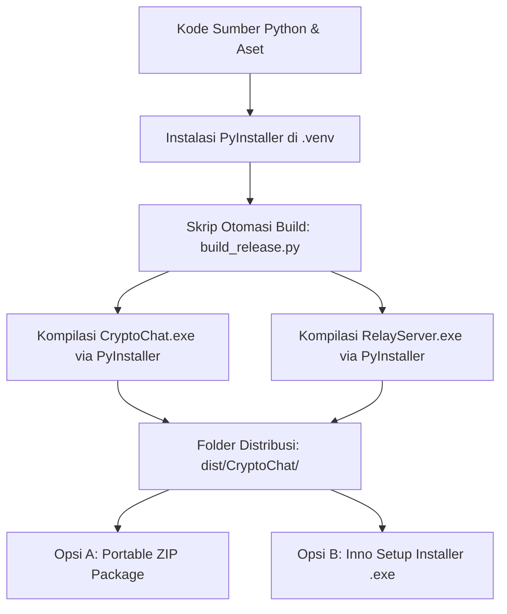

# Panduan Packaging dan Distribusi Aplikasi (.EXE & Installer Windows)

Dokumen ini mendefinisikan rencana terperinci, arsitektur teknis, pengelolaan aset, konfigurasi spesifikasi PyInstaller, serta alur pembuatan berkas eksekusi mandiri (*standalone executable* `.exe`) dan penginstal resmi (*installer wizard*) untuk prototipe aplikasi chat kriptografi desktop.

Dengan implementasi ini, aplikasi dapat didistribusikan dan diinstal pada laptop atau PC Windows lain **tanpa mengharuskan perangkat target memiliki Python, Git, pip, C-compiler, atau dependensi apa pun**.

---

## 1. Tujuan & Sasaran Distribusi

1. **Zero-Dependency Target Device:** Pengguna di perangkat lain cukup menerima berkas `.exe` atau installer, melakukan *double-click*, dan aplikasi langsung berjalan dengan performa native.
2. **Zero-CLI Experience:** Menghilangkan keharusan membuka terminal PowerShell/CMD untuk menjalankan klien; konfigurasi User ID, Passphrase, dan alamat IP Relay Server dilakukan sepenuhnya melalui antarmuka visual (GUI).
3. **Data Persistence & Portability:** Berkas database SQLite (`data/<user>.db`), keystore identitas, dan state counter anti-replay tersimpan secara persisten di lokasi yang aman dan *writable* pada mesin target.
4. **Keamanan & Integritas Primitif:** Seluruh modul C/Rust (OpenSSL bindings dari pustaka `cryptography`), parser `customtkinter`, dan `matplotlib` terkompilasi utuh ke dalam bundel biner.

---

## 2. Struktur Dua Berkas Executable yang Dihasilkan

Untuk mempermudah simulasi multi-device di jaringan lokal (LAN), sistem akan dikompilasi menjadi dua berkas eksekusi mandiri:

| Berkas Executable | Jenis Eksekusi | Peruntukan | Deskripsi |
| :--- | :--- | :--- | :--- |
| **`CryptoChat.exe`** | Windowed GUI (`--noconsole`) | Klien Pengguna (Alice / Bob) | Antarmuka obrolan desktop CustomTkinter, dialog identitas, dan panel visualizer kriptografi real-time. Tidak memunculkan jendela hitam console. |
| **`RelayServer.exe`** | Console Application (`--console`) | Host Jaringan LAN | Server perantara zero-knowledge. Membuka jendela terminal server untuk memantau log lalu lintas paket ciphertext, IP klien terhubung, dan direktori public key secara transparan. |

---

## 3. Penyesuaian Antarmuka & Jalur Berkas (*Prerequisites*)

Sebelum proses kompilasi `.exe` dilakukan, ada dua penyesuaian kode penting yang harus disiapkan:

### 3.1. Penambahan Konfigurasi IP Relay pada GUI Login (`IdentityDialog`)
Pada mode berkas `.exe`, pengguna tidak lagi menggunakan argumen CLI seperti `--relay-host 192.168.1.10`. Oleh karena itu, form login [client/ui/key_dialog.py](file:///c:/Users/dimaa/Documents/kripto/client/ui/key_dialog.py) disempurnakan dengan menambahkan kolom:
- **Alamat IP Relay Server:** (Nilai bawaan: `127.0.0.1` atau `0.0.0.0`, dapat diedit menjadi IP laptop host LAN, misal: `192.168.1.10`).
- **Nomor Port Relay:** (Nilai bawaan: `8000`).

Dengan demikian, saat membuka `CryptoChat.exe` di Laptop 2 (Bob), Bob cukup mengetikkan IP Laptop 1 di kolom tersebut tanpa perlu menyentuh command prompt.

### 3.2. Penanganan Jalur Berkas Runtime (*Dynamic Resource Path Handling*)
Ketika aplikasi Python dibundel menjadi single-file `.exe` oleh PyInstaller, berkas internal diekstrak sementara ke folder `%TEMP%/_MEIxxxx/` (`sys._MEIPASS`).
- **Aset Statis (Tema CustomTkinter, Icon):** Harus dibaca dari `sys._MEIPASS`.
- **Basis Data Persisten (`data/*.db`):** **TIDAK BOLEH** disimpan di `sys._MEIPASS` (karena akan terhapus saat aplikasi ditutup). Folder `data/` harus dibuat relatif terhadap lokasi berkas `.exe` berada:
  ```python
  import sys, os

  def get_base_dir() -> str:
      """Mengembalikan direktori permanen tempat file .exe atau skrip python berada."""
      if getattr(sys, 'frozen', False):
          return os.path.dirname(sys.executable)
      return os.path.abspath(os.path.join(os.path.dirname(__file__), ".."))
  ```

---

## 4. Spesifikasi Teknis PyInstaller

Proses kompilasi akan menggunakan berkas spesifikasi PyInstaller otomatis (`CryptoChat.spec` dan `RelayServer.spec`) untuk memastikan tidak ada pustaka dinamis (DLL) atau aset tema yang tertinggal.

### 4.1. Tantangan Khusus & Solusi Kompilasi:
1. **Pustaka CustomTkinter:**
   - Memiliki dependensi berkas konfigurasi tema JSON (`themes/*.json`) dan font khusus.
   - Solusi: Menambahkan opsi `--collect-all customtkinter` pada PyInstaller agar seluruh aset desain dan skrip internal CustomTkinter otomatis terangkut ke dalam biner.
2. **Pustaka Cryptography (OpenSSL / Rust Bindings):**
   - Memerlukan berkas biner `.pyd` dan DLL OpenSSL (`libcrypto-3-x64.dll`).
   - Solusi: Menambahkan opsi `--collect-all cryptography` dan `--collect-submodules src.crypto`.
3. **Pustaka Matplotlib (Visualisasi Benchmark):**
   - Menggunakan backend GUI dinamis.
   - Solusi: Mengumpulkan backend standar Tkinter (`matplotlib.backends.backend_tkagg`).

---

## 5. Alur Pembuatan Berkas `.exe` (Build Process)

Berikut adalah tahapan pembuatan berkas biner:



### Perintah Kompilasi Mandiri (Contoh CLI):
```powershell
# 1. Menginstal PyInstaller di virtual environment
pip install pyinstaller

# 2. Kompilasi Klien GUI CryptoChat.exe (Windowed, Single-Dir / Single-File)
pyinstaller --noconsole --name "CryptoChat" `
  --collect-all customtkinter `
  --collect-all cryptography `
  --add-data "data;data" `
  client/main.py

# 3. Kompilasi Server Relay RelayServer.exe (Console)
pyinstaller --console --name "RelayServer" `
  relay/server.py
```

---

## 6. Dua Opsi Distribusi untuk Laptop Lain

Setelah proses build selesai di folder `dist/`, pengembang dapat memilih salah satu dari dua metode distribusi berikut:

### Opsi A: Paket Portabel (*Portable Standalone ZIP*) — Sangat Direkomendasikan untuk Demo
- **Bentuk:** Berkas terkompresi `CryptoChat_Portable_v1.0.zip`.
- **Isi Folder:**
  ```text
  CryptoChat_Portable/
  ├── CryptoChat.exe        <- Dobel-klik untuk membuka antarmuka chat
  ├── RelayServer.exe       <- Dobel-klik di laptop host untuk menyalakan relay
  ├── data/                 <- Folder database lokal (dibuat otomatis)
  └── PANDUAN_RINGKAS.txt   <- Petunjuk pemakaian singkat
  ```
- **Cara Pakai di Laptop Lain:**
  1. Ekstrak ZIP di Laptop 2 (misal di Desktop atau Downloads).
  2. Klik dua kali `CryptoChat.exe`.
  3. Masukkan Display Name, Passphrase, dan IP Laptop 1 $\to$ langsung terhubung dan siap mengobrol!

---

### Opsi B: Wizard Penginstal Resmi (*Windows Setup Wizard .exe*)
Jika ingin tampilan profesional layaknya aplikasi komersial dengan wizard *"Next $\to$ Next $\to$ Install"*:
- Menggunakan alat open-source **Inno Setup**.
- Menghasilkan berkas instalasi tunggal: `CryptoChat_Setup_v1.0.exe`.
- **Fitur Installer:**
  - Memilih direktori instalasi (misal: `C:\Program Files\CryptoChat` atau `%LOCALAPPDATA%\CryptoChat`).
  - Membuat shortcut otomatis di **Desktop** dan **Start Menu**.
  - Menyertakan uninstaller bersih (*Add/Remove Programs* Windows).

---

## 7. Rencana Pengujian Validasi pada Mesin Target (*Clean Machine Test*)

Untuk memastikan berkas `.exe` benar-benar mandiri dan bebas galat di komputer lain, pengujian akan dilakukan berdasarkan checklist berikut:

| No | Parameter Uji | Prosedur Pengujian | Hasil yang Diharapkan |
| :--- | :--- | :--- | :--- |
| 1 | **Lingkungan Bersih (No Python)** | Jalankan `CryptoChat.exe` pada mesin tanpa instalasi Python. | Aplikasi terbuka lancar tanpa pesan error DLL hilang. |
| 2 | **Pembangkitan Kunci RSA** | Buat identitas pengguna baru dan masukkan passphrase. | Kunci RSA-2048 tergenerasi dan tersimpan di database lokal. |
| 3 | **Koneksi Relay LAN** | Masukkan IP Laptop Host pada kolom Relay IP di GUI. | Status koneksi relay terhubung (`OK`) dan kunci publik terpublikasi. |
| 4 | **Enkripsi & Dekripsi End-to-End** | Kirim pesan dari Laptop 1 ke Laptop 2. | Pesan didekripsi sempurna; panel visualizer menampilkan tahapan kriptografi secara akurat. |
| 5 | **Simulasi Serangan di Mesin Fisik** | Klik tombol `🔁 Uji Replay` dan `⚡ Tamper 1-Byte`. | Pertahanan Anti-Replay dan Verifikasi Tag AES-GCM menolak paket secara tepat di mesin kedua. |

---

## 8. Langkah Tahapan Eksekusi Selanjutnya

1. **Langkah 1:** Memperbarui [client/ui/key_dialog.py](file:///c:/Users/dimaa/Documents/kripto/client/ui/key_dialog.py) dan [client/app.py](file:///c:/Users/dimaa/Documents/kripto/client/app.py) agar dialog login memiliki input field alamat IP Relay Server.
2. **Langkah 2:** Memperbarui [client/main.py](file:///c:/Users/dimaa/Documents/kripto/client/main.py) untuk integrasi parameter jaringan.
3. **Langkah 3:** Menginstal dependensi `pyinstaller` pada lingkungan virtual (`.venv`).
4. **Langkah 4:** Membuat skrip otomatisasi build `build_exe.py` untuk mengompilasi `CryptoChat.exe` dan `RelayServer.exe`.
5. **Langkah 5:** Melakukan uji coba eksekusi file biner yang dihasilkan di folder `dist/`.
