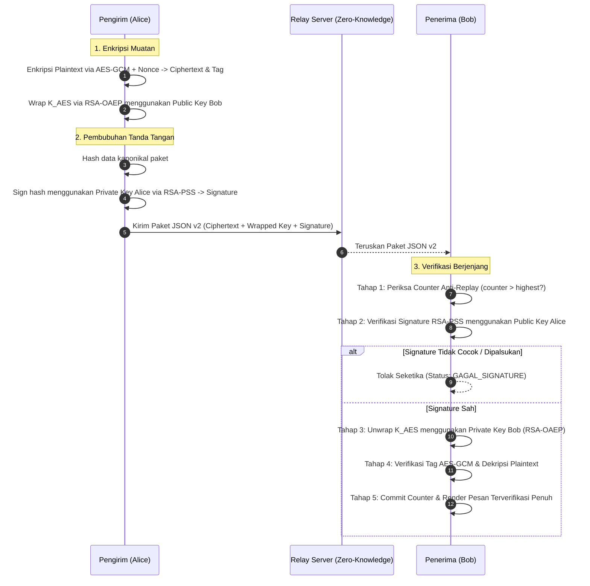

# Rencana Peningkatan: Integrasi Tanda Tangan Digital RSA-PSS (Authenticity & Non-Repudiation)

Dokumen ini memuat spesifikasi teknis, landasan matematis, skema paket data, alur kerja verifikasi berjenjang, serta rencana pengujian untuk mengatasi kelemahan ketiadaan tanda tangan digital (*No Digital Signature*) pada skema enkripsi hybrid saat ini dengan mengintegrasikan **RSA-PSS (Probabilistic Signature Scheme)** menggunakan hash SHA-256.

---

## 1. Latar Belakang & Motivasi Ilmiah

Pada arsitektur sistem saat ini:
- **AES-256-GCM** menjamin kerahasiaan (*confidentiality*) dan integritas (*integrity*) pesan.
- **RSA-2048-OAEP** menjamin kerahasiaan pembungkusan kunci simetris (*key wrapping*).

### Masalah Keamanan yang Belum Terpecahkan (*Identity Spoofing*):
Algoritma RSA-OAEP murni adalah mekanisme enkripsi asimetris, **bukan pembuktian identitas pengirim**. 
Karena Kunci Publik Bob bersifat terbuka untuk umum:
> Siapa pun di jaringan (misalnya penyerang bernama Eve) dapat membungkus kunci AES dengan Kunci Publik Bob, mengenkripsi pesan sampah, dan menuliskan `"sender": "alice"` pada muatan paket JSON.
> 
> Ketika Bob menerima paket tersebut, Bob dapat membukanya dan Tag GCM terbukti cocok, namun **Bob tidak memiliki bukti matematis bahwa Alice yang benar-benar menulis pesan tersebut**. Alice pun dapat menyangkal bahwa ia pernah mengirimkannya (*repudiation*).

### Solusi Peningkatan:
Mengintegrasikan **Tanda Tangan Digital RSA-PSS** menggunakan pasangan kunci RSA-2048 yang sudah dimiliki oleh masing-masing klien lokal.

---

## 2. Landasan Matematis RSA-PSS (PKCS#1 v2.2 / RFC 8017)

### Mengapa Memilih RSA-PSS Dibandingkan PKCS#1 v1.5 Signature?
1. **Keamanan Provable (*Provable Security*):** RSA-PSS dirancang oleh Bellare dan Rogaway dengan bukti matematis formal di bawah *Random Oracle Model*.
2. **Ketiadaan Salt pada v1.5:** PKCS#1 v1.5 bersifat deterministik dan rentan terhadap berbagai manipulasi format padding. RSA-PSS bersifat probabilistik (*randomized signature*) dengan menyertakan salt acak (32 byte) pada setiap operasi penandatanganan.

### Parameter Teknis yang Ditetapkan:
- **Panjang Modulus Kunci:** RSA 2048-bit (256 byte).
- **Fungsi Hash Utama:** SHA-256 ($hLen = 32\text{ byte}$).
- **Mask Generation Function (MGF):** MGF1 dengan SHA-256.
- **Panjang Salt ($sLen$):** 32 byte (ekivalen dengan panjang digest hash).
- **Panjang Tanda Tangan Digital:** 256 byte (512 karakter heksadesimal).

---

## 3. Skema Data yang Ditandatangani (*Payload Binding*)

Untuk mencegah penyerang memotong tanda tangan dan menempelkannya ke pesan lain (*signature splicing attack*), pengirim **tidak menandatangani plaintext polos**, melainkan menandatangani ikatan kanonikal seluruh komponen paket terenkripsi:

$$\text{Data To Sign} = \text{SHA-256}( \text{version} \parallel \text{sender} \parallel \text{receiver} \parallel \text{counter} \parallel \text{nonce} \parallel \text{ciphertext} \parallel \text{tag} )$$

### Struktur Format Paket JSON v2:
```json
{
  "version": 2,
  "sender": "alice",
  "receiver": "bob",
  "counter": 7,
  "wrapped_key": "<Base64 256-byte RSA-OAEP Bob>",
  "nonce": "<Base64 12-byte GCM Nonce>",
  "ciphertext": "<Base64 AES-GCM Ciphertext>",
  "tag": "<Base64 16-byte GCM Tag>",
  "signature": "<Base64 256-byte RSA-PSS Alice>"
}
```

---

## 4. Alur Kerja Kriptografi Lengkap dengan Digital Signature



---

## 5. Matriks Peningkatan Keamanan

| Parameter Keamanan | Skema Awal (v1) | Skema Baru dengan RSA-PSS (v2) | Status Keamanan |
| :--- | :--- | :--- | :--- |
| **Kerahasiaan Isi (*Confidentiality*)** | Terjamin (AES-256-GCM + RSA-OAEP) | Terjamin (AES-256-GCM + RSA-OAEP) | Tetap Terproteksi Penuh |
| **Integritas Data (*Data Integrity*)** | Terjamin (GCM Tag 128-bit) | Terjamin Ganda (GCM Tag + RSA-PSS) | Sangat Kuat |
| **Ketahanan Replay (*Anti-Replay*)** | Terjamin (Counter Monotonik) | Terjamin (Counter Monotonik) | Tetap Terproteksi Penuh |
| **Keaslian Pengirim (*Authenticity*)** | ❌ Lemah (Hanya teks `"sender": "alice"`) | ✅ **Terbukti Matematis (RSA-PSS Alice)** | **BERHASIL DIATASI** |
| **Anti-Penyangkalan (*Non-Repudiation*)**| ❌ Tidak Ada (Alice bisa menyangkal) | ✅ **Ada (Hanya Alice pemegang private key)** | **BERHASIL DIATASI** |
| **Deteksi Pemalsuan Identitas** | ❌ Gagal jika Eve mengirim pesan ke Bob | ✅ **Eve langsung tertolak di Tahap 2** | **BERHASIL DIATASI** |

---

## 6. Integrasi Mode Visualizer pada Antarmuka (GUI)

Dengan penambahan tahap verifikasi tanda tangan digital, panel kanan visualizer di jendela obrolan akan menampilkan alur inspeksi yang semakin komprehensif bagi dosen penguji:

- **Tahap 1:** Pemeriksaan Counter Anti-Replay `[OK / FAIL]`
- **Tahap 2:** **Verifikasi Tanda Tangan Digital Pengirim (RSA-PSS) `[OK / FAIL]`** *(Baru)*
  - Menampilkan cuplikan 512 karakter Hex signature.
  - Memvalidasi keabsahan terhadap Kunci Publik pengirim.
- **Tahap 3:** Pembukaan Kunci Simetris (RSA-OAEP Unwrap) `[OK / FAIL]`
- **Tahap 4:** Rekonstruksi Metadata Kanonikal AAD `[OK / FAIL]`
- **Tahap 5:** Verifikasi Integritas AES-GCM & Commit `[OK / FAIL]`

---

## 7. Rencana Pengujian Otomatis (*Unit Test Plan*)

Rangkaian pengujian unit baru akan ditambahkan pada `tests/test_signature.py`:

1. `test_rsa_pss_sign_and_verify_valid()`: Memastikan tanda tangan yang dibangkitkan pengirim sah dapat diverifikasi 100% oleh penerima.
2. `test_rsa_pss_rejects_tampered_signature()`: Memastikan jika penyerang mengubah 1 byte pada signature, verifikasi langsung gagal.
3. `test_rsa_pss_rejects_tampered_ciphertext()`: Memastikan jika penyerang mengubah ciphertext atau metadata paket, tanda tangan pengirim menjadi tidak valid.
4. `test_rsa_pss_rejects_wrong_sender_key()`: Memastikan jika Eve mencoba memalsukan identitas Alice menggunakan kunci privat milik Eve, verifikasi terhadap kunci publik Alice seketika menolaknya.

---

## 8. Langkah Tahapan Eksekusi

- [ ] **Langkah 1:** Membuat modul utilitas `src/crypto/rsa_pss.py` dengan fungsi `sign_packet_data()` dan `verify_packet_signature()`.
- [ ] **Langkah 2:** Memperbarui model data `MessagePacket` di `src/messaging/packet.py` untuk mendukung field `signature`.
- [ ] **Langkah 3:** Memperbarui alur pengiriman dan penerimaan pada `client/controllers/chat_controller.py`.
- [ ] **Langkah 4:** Menambahkan visualisasi tahap RSA-PSS pada `client/controllers/visualizer_controller.py` dan `client/ui/visualizer_panel.py`.
- [ ] **Langkah 5:** Menambahkan unit test otomatis di `tests/test_signature.py` dan memverifikasi kelulusan 100%.
